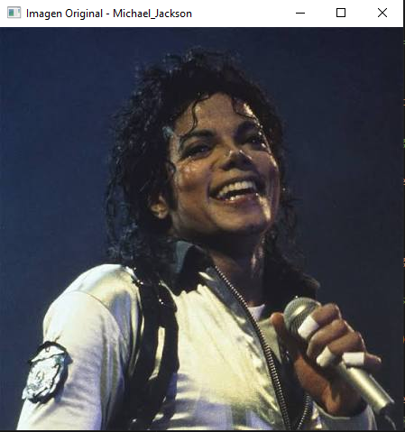
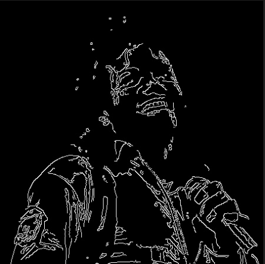
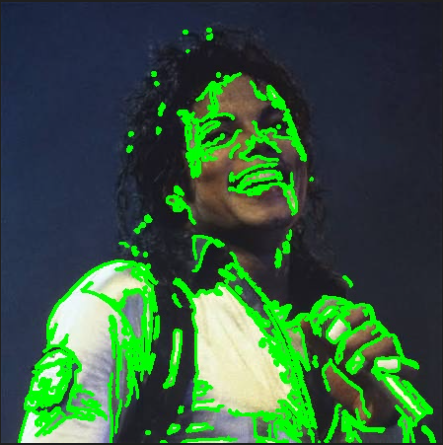
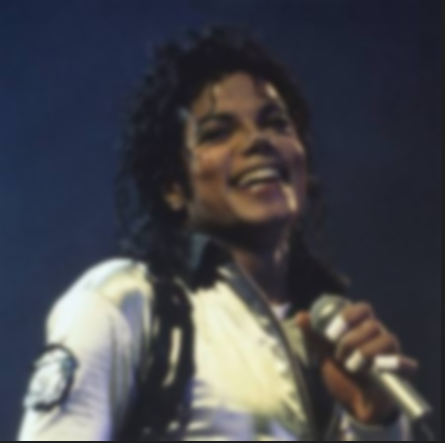
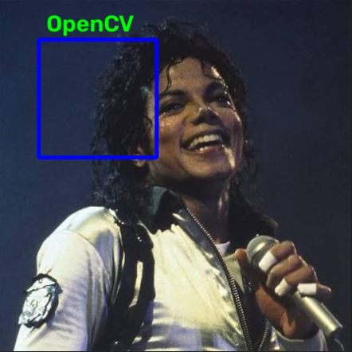
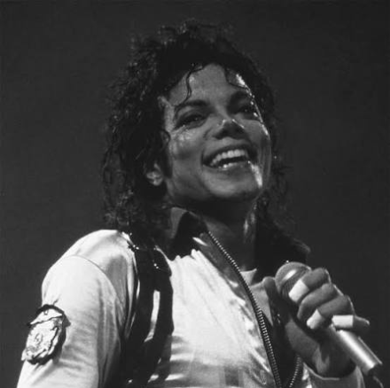
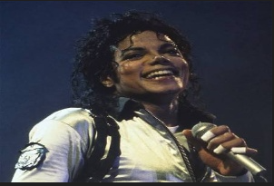
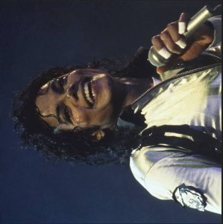
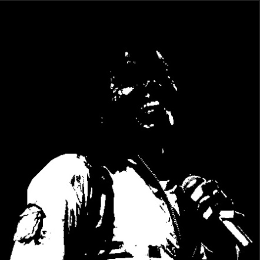
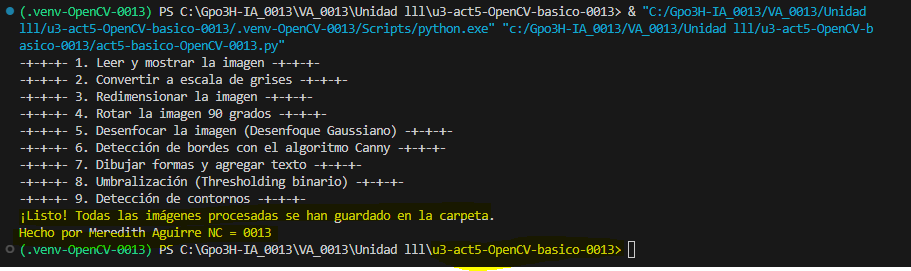

## UIII Act 5 OpenCV Práctica Alumno
## Meredith Aguirre NC = 0013
## Imagén Original

## Bordes

## Contornos

## Desenfocada

## Formas con texto

## Grises 

## Redimensionada

## Rotada

## Umbral

## Resultados en la terminal
